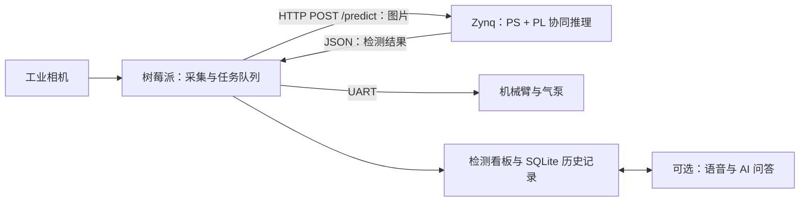

# 铝片表面缺陷检测与智能分拣 · 树莓派端

本项目采用 **树莓派 + Zynq-7020 双板异构架构**，完成铝片图像采集、缺陷识别、分拣控制与检测记录查询。本仓库提供 **树莓派开发板端软件**：工业相机采集、Zynq 推理客户端、机械臂与气泵控制、检测看板，以及可选的语音与 AI 问答。

**另一块开发板的工程：[Zynq-7020 端 FPGA_AMD_Zynq](https://github.com/huddddle/FPGA_AMD_Zynq)**。Zynq 仓库提供 RTL、PS 推理服务、Vivado 构建脚本、综合与实现报告及板端推理结果。

参赛项目：2026 全国大学生嵌入式芯片与系统设计竞赛 FPGA 赛道，AMD 自主选题初级组；团队成员为大三本科生。FPGA 器件为 Zynq-7000 系列 XC7Z020，硬件工程使用 Vivado 2022.2；树莓派通过 MobaXterm 和 SSH 开发部署。

## 系统分工与功能



- **采集与检测调度**：海康 MVS 或 V4L2 相机，圆形工件定位、触发拍照、有界任务队列和失败恢复。
- **推理通信**：上传图片至 Zynq 的 `POST /predict`，文件字段为 `image_file`；解析类别、分数与检测框。
- **分拣控制**：通过 UART 控制五个关节及气泵，提供参数调试网页和动作序列。
- **看板与记录**：实时预览、检测统计、图片、历史记录及分产线 AI 对话。
- **多产线管理**：支持产线 1～5 的数据隔离；当前一台相机接入 `PRODUCTION_LINE_ID` 指定的产线，其余产线显示无信号并保留历史查询。

## 环境与硬件

| 项目 | 要求或配置 |
| --- | --- |
| 树莓派系统 | Linux，海康 SDK 安装脚本面向 ARM64 / aarch64；具体板型与系统镜像版本待补充 |
| Python | 3.10+；依赖按功能固定在 `requirements/` |
| 相机 | 海康 MVS 工业相机，或使用 V4L2 的 UVC 相机 |
| 推理板 | Zynq-7020，默认服务 `http://192.168.10.111:8080/predict` |
| 板间连接 | 以太网，同一子网；本仓库默认树莓派有线地址 `192.168.10.120/24` |
| 控制串口 | 115200、8N1；物理引脚 8/TX、9/GND、10/RX，接线电平与控制板匹配 |
| 页面 | 检测看板 8000；机械臂调试 8088 |
| 可选组件 | 麦克风、扬声器、Vosk 中文模型、语音合成模型及模型服务 API Key |

## 仓库结构与比赛目录对照

本仓库保留模块平铺布局，Python 导入和已有启动脚本均以仓库根目录为基准。与比赛推荐目录的对应关系如下。

| 推荐目录 | 本仓库位置与内容 |
| --- | --- |
| `src/` | `common/`、`vision/`、`robot/`、`dashboard/`、`voice/`：树莓派源码 |
| `sim/` | `tests/` 为测试源码；`sim/` 提供验证入口与结果说明 |
| `build/` | 环境准备说明；安装实现位于 `scripts/setup/`，依赖位于 `requirements/` |
| `board/` | 接线、部署和联调说明；运行实现位于 `scripts/start/`、`scripts/stop/` |
| `data/` | 软件测试数据与参考判定说明，固定测试输入也位于 `tests/` |
| `skill/` | 双板接口、产线隔离和部署验证的复用方法 |
| `report/` | 树莓派设计说明、大模型协作记录与软件验证结果 |

Zynq 的 RTL 仿真、FPGA 构建与实现报告、bit 和模型位于[配套 Zynq 仓库](https://github.com/huddddle/FPGA_AMD_Zynq)。详细目录见[目录说明](docs/project_structure.md)。本仓库文件名使用小写英文；扩展名及 Git 隐藏配置保留点号。

## 从零部署到树莓派

### 1. 下载工程并安装环境

在 MobaXterm 中建立到树莓派的 SSH 会话。**以下使用树莓派 Bash：**

```bash
git clone https://github.com/Tony-Chen-dot/FPGA-AMD-RaspberryPi.git raspberry_pi && cd raspberry_pi && bash install.sh
```

`&&` 保证前一步成功再继续。`install.sh` 安装系统和 Python 依赖、配置 UART 与串口权限，并建立 `.venv`。需要联网及 sudo 权限；首次修改 UART 或 dialout 后，按安装提示重启并重新登录。安装失败先检查报错的系统包或 Python 依赖。

海康相机还需要厂商 Linux ARM64 MVS 安装包。**树莓派 Bash，在仓库根目录执行：**

```bash
bash scripts/setup/install_camera_sdk.sh /path/to/mvs_arm64.deb
```

将参数替换为已下载的厂商安装包路径；脚本检查架构并安装 SDK。默认位置为 `/opt/MVS`，导入失败时检查安装包架构和 `HIKROBOT_SDK_PATH`。UVC 相机在配置中选择 `v4l2`。

### 2. 配置网络、相机与控制

编辑根目录 `config.sh`：

| 配置 | 用途 |
| --- | --- |
| `PRODUCTION_LINE_ID` | 当前相机归属的产线，1～5 |
| `PI_ETH0_IP`、`ZYNQ_IP` | 树莓派和 Zynq 的有线地址，保持同一子网 |
| `CAMERA_SOURCE`、`HIKROBOT_CAMERA_SERIAL` | 相机类型与设备序列号 |
| `BOARD_INPUT_SIZE`、`BOARD_SEND_RAW` | 默认 320×320、JPEG 上传；原始 RGB 模式需双方支持 |
| `ARM_SERIAL_PORT`、`ACTION_DIRECTION_MODE` | 串口与左右分拣方向 |
| `VOICE_WAKE_ENABLED` | 后台语音助手开关，默认关闭 |

启动脚本加载 `config.sh` 时会配置有线地址，并检查相机与 UART。先按[Zynq 上板说明](https://github.com/huddddle/FPGA_AMD_Zynq/blob/main/board/readme.md)启动推理服务，再在树莓派启动采集。

### 3. 标定、启动与停止

**树莓派 Bash，在仓库根目录打开机械臂调试服务：**

```bash
bash start_robot_debug.sh
```

浏览器访问 `http://<树莓派IP>:8088`，按[机械臂说明](docs/robot_control.md)调整姿态和等待时间；保存到 `runtime/robot/servo_params.json`。连接真实控制板后，页面动作会驱动机械臂与气泵，先确认运动空间。

**树莓派 Bash，启动整套检测与分拣：**

```bash
bash start_all.sh
```

启动过程依次准备控制器、看板、采集和按配置启用的语音服务。浏览器打开 `http://<树莓派IP>:8000`。预检失败会输出相机或串口原因，运行日志位于 `runtime/logs/line_N/`。

**树莓派 Bash，停止本项目服务：**

```bash
bash stop_all.sh
```

脚本停止看板、视觉、语音和机械臂调试进程。仅调试视觉时可使用 `bash scripts/start/vision_only.sh`；该 Bash 命令启动相同的采集与看板链路，并关闭机械臂预检和动作。

### 4. 无硬件软件验证

**Linux / WSL Bash，在仓库根目录执行：**

```bash
python3 -m venv .venv && .venv/bin/python -m pip install -r requirements/test.txt && TEST_PYTHON="$PWD/.venv/bin/python" bash sim/verify.sh
```

`&&` 按顺序建立环境、安装测试依赖并验证；`TEST_PYTHON` 指定本次解释器。另需 Node.js 检查前端图片 URL；验证调用单元/接口测试及 Shell 语法检查，不加载 `config.sh`。Linux 文件锁测试依赖 `fcntl`，因此完整测试使用 Linux / WSL。结果见[验证记录](report/software_validation.md)。

## 数据与常用文档

检测数据库及图片默认保存在 `~/Database/vision-dashboard/lines/line_N/`，可用 `DASHBOARD_DATA_DIR` 设置根目录；机械臂标定参数在 `runtime/robot/servo_params.json`。换机部署时需迁移这两类数据，Git 源码下载不会携带它们。

- [硬件与双板联调](board/readme.md)、[数据协议](docs/fpga_data_protocol.md)、[检测看板](docs/dashboard.md)。
- [机械臂](docs/robot_control.md)、[语音助手](docs/voice_assistant.md)、[设计报告](report/design_report.md)。
- [技能包](skill/readme.md)、[协作记录](report/ai_collaboration.md)、[目录对照](docs/submission_layout.md)。
- 系统海报和比赛指南统一保存在 [Zynq 仓库材料目录](https://github.com/huddddle/FPGA_AMD_Zynq/tree/main/report/materials)。

## 已知局限与 TODO

- 当前实物配置为一台相机、一个采集产线；五产线同时采集和调度待扩展。
- 旧数据库迁移在本次 WSL / Windows 挂载目录测试中失败，修改前版本可复现；需在目标树莓派上复验和定位，详见[验证记录](report/software_validation.md)。
- 树莓派具体型号、系统镜像版本、相机与控制板型号、接线照片和标定参数样例待补充。
- 从触发采集到机械臂完成分拣的时延分布、成功率和连续运行记录待补充。
- 海康 SDK、Vosk 及语音合成模型需另行安装；后台语音需要音频设备和模型服务配置。
- 原始开发期大模型对话记录待汇总；本次文档整理的提示词、回答与修正过程见协作记录。

## 开源协议

本项目原创代码与文档采用 [MIT](license)。随附前端库和外部 SDK、模型保留其原有许可，见[第三方组件说明](report/third_party_notices.md)。
